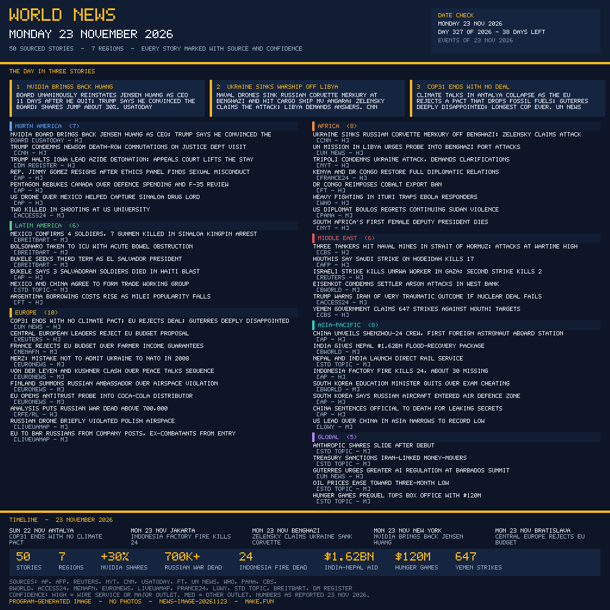

# news-image-20261123 — World News, Monday 23 November 2026

[](https://make.fun/bounty/news-image-20261123?utm_source=github&utm_medium=readme&utm_campaign=news-image-20261123)
[](https://make.fun/bounty/news-image-20261123/leaderboard?utm_source=github&utm_medium=readme&utm_campaign=news-image-20261123)
[](https://make.fun/bounty/news-image-20261123?utm_source=github&utm_medium=readme&utm_campaign=news-image-20261123)

One 1024×1024 image summing up the world news of **Monday 23 November 2026** — built for the [make.fun bounty](https://make.fun/bounty/news-image-20261123).



## What is on the image

- **50 sourced stories across 7 regions**
  - North America — 7
  - Latin America — 6
  - Europe — 10
  - Africa — 8
  - Middle East — 6
  - Asia-Pacific — 8
  - Global — 5
- **3 lead stories**
  1. NVIDIA brings back Huang — the board unanimously reinstates Jensen Huang as CEO 11 days after he quit; Trump says he convinced the board; shares jump about 30%.
  2. Ukraine sinks warship off Libya — naval drones sink the Russian corvette Merkury at Benghazi and hit the cargo ship MV Angara; Zelensky claims the attack; Libya demands answers.
  3. COP31 ends with no deal — climate talks in Antalya collapse as the EU rejects a pact that drops fossil fuels; Guterres calls it deeply disappointing; the longest COP ever.
- **Timeline** — 5 entries, 22–23 November 2026 (Antalya, Jakarta, Benghazi, New York, Bratislava).
- **Numbers band** — 50 stories, 7 regions, +30% Nvidia shares, 700K+ Russian war dead, 24 Indonesia fire dead, $1.62bn India–Nepal aid, $120m Hunger Games, 647 Yemen strikes.
- **Date check** — Monday 23 Nov 2026, day 327 of 2026, 38 days left.

## Confidence rule

Every story is marked with its source and a confidence letter:

- **H (HIGH)** — wire service or major outlet (AP, AFP, Reuters, NYT, CNN, WSJ, BBC).
- **M (MED)** — any other outlet.

All 50 stories were checked against their publication dates: each one happened on, or was first reported on, 23 November 2026 (the timeline's first entry is the COP31 close on Sunday 22 November, the day's only carry-over).

## How to run

Pure Python 3 standard library — no dependencies, no network, no clock, no randomness. The program writes one PNG to the output directory (default `/output`).

```bash
python3 main.py
# or, to choose the output directory:
MAKEFUN_OUTPUT_DIR=out python3 main.py
```

Two runs produce byte-identical files. The output is a 1024×1024 PNG under 1 MiB.

## How it is made

- A hand-made 5×7 pixel font (uppercase A–Z, digits, punctuation), drawn at three scales.
- A small PNG encoder written in this file (IHDR / IDAT / IEND, zlib compression, CRC per chunk).
- Deep-navy page with a gold header, three lead panels, two story columns grouped by region, a timeline strip, a numbers band and a sources footer. No photos — the image is fully program-generated.

## Competition

- Bounty: https://make.fun/bounty/news-image-20261123
- Prize: $100 (top 50 paid). Deadline: 25 November 2026, 08:00 Beijing. Results: 9 December 2026, 16:00.
- Join make.fun with my referral link: https://make.fun/r/x0yy8q40

## License

MIT — see [LICENSE](LICENSE).
